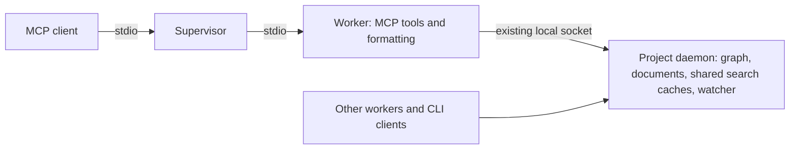

# MCP memory and connection lifecycle

## Current ownership



The project daemon already serves multiple clients. Its held graph handle keeps
reads and writes on one database instance; reopening an embedded database for
each request would undo that ownership guarantee. The filesystem watcher does
not require every MCP worker to retain a separate copy of project search data.

The daemon caches symbol search rows, search text, BM25 data, embeddings and
an HNSW index. MCP unified symbol search, name search, semantic search and the
L3 ranking in memory context execute there; the worker receives only results.
Document ranking also runs there through the existing document-store provider.
These are rebuildable performance caches, shared by every client of that
project. A live client pipe is evidence of a connected transport, not ongoing use of those
caches or an open chat. A broker may keep its Codex app-server connected after a
review command exits.

## Idle policy

Search contexts, embedding data and HNSW indexes expire after five minutes
without a cache hit or insertion. The daemon checks once per second between
active reads. Background indexers do not keep unused search data alive. It
also releases these caches when no client leases or active reads remain. The
explicit local backend retains the same idle policy in its worker. A busy
mutex is skipped; eviction never interrupts an active call, and owned results remain valid. The next request follows the normal cache-miss
path and rebuilds the data.

Set the process environment `INFIGRAPH_CACHE_IDLE_SECS`, or the user setting
in `~/.infigraph/config.toml`:

```toml
[cache]
idle_secs = 300 # 0 disables timed eviction; last-client release still applies
```

This is time since the last cache use, not an absolute memory cap. Model data,
language registries and allocator-retained pages can remain resident. Dropping
cached values therefore does not promise an equal immediate RSS decrease.

Three independent lifecycles apply:

| Event | Behavior |
| --- | --- |
| Search/vector cache is idle | Release its data; keep the transport usable |
| Last client lease and active read end | Release shared search/vector state on the next maintenance tick |
| Stdio client closes its final writer | Supervisor and worker exit |
| Supervisor dies | Worker observes EOF or its parent monitor and exits |
| Project daemon has no leases, requests or work | Existing 30-minute idle-exit policy applies |

Hosts should release temporary thread subscriptions and MCP connections after
reviews and one-shot tasks, including failure paths. Agent instructions are
helpful reminders, but only the owning host can close its transport. Closing a
wrapper's broker socket does not close the broker's app-server connection.

## Shared search direction

Search state and ranking now live in the project daemon. Typed symbol and
document search operations use its existing read-service protocol and bounded
read pool. The MCP tool API and result formatting stay stable. Search state is
shared per project without a new socket or IPC framework. The explicit local
backend calls the same core search implementation, rather than a second copy.
A cache build is single flight across concurrent clients; graph generation,
store identity, graph/WAL metadata and embedding metadata invalidate it after
writes or a store replacement.

Do not expose the entire MCP dispatcher as a daemon operation: tools that call
back into the daemon could recurse or deadlock its coordinator. Share the
search service below the tool adapter, and retain the same local/remote query
abstraction.

Keep the supervisor and worker separation while the worker still runs substantial
tool logic: it contains crashes and enforces deadlines. Once execution and
large state live in the daemon, measure the remaining adapter cost before
deciding whether to remove the worker hop. Making today's heavy worker a
second multi-client server would duplicate the daemon's role.

This change implements shared daemon search, cache eviction and host cleanup
guidance. Removal of a process hop remains a separate architectural decision.

## Incident findings and host cleanup

The idle MCP processes inspected on 2026-11-11 still had live stdin writers in
Codex app-servers. They were connected transports, rather than workers failing
to observe a dead supervisor. Four of the five inspected app-server hosts came
from Claude's persistent Codex review/delegation broker; the fifth was the
ChatGPT app's app-server. This does not establish a one-to-one mapping between
open chats and MCP processes.

With the user's authorization, 21 Codex-initiated Infigraph supervisors and
their 21 workers were stopped with SIGTERM, without force. The readback found
zero remaining Codex supervisors and preserved all seven Claude supervisors.
Their combined measured MCP physical footprint fell from 17.308 to 3.356 GiB,
releasing about 14 GiB. These are measurements at that cleanup, not a claim
about how many sessions a host may subsequently create.

Owned shutdown probes confirmed worker exit after stdin EOF (7–8 ms),
supervisor TERM/KILL (26/8 ms), and a supervisor death while serving HTTP
(4.969 s, within the existing five-second parent monitor interval).

A separate local fix to the Codex review plugin unsubscribes temporary review
and ephemeral task threads in success and failure paths, and releases broker
subscriptions when their owning wrapper disconnects. Persistent and resumed
tasks retain their contexts. It is committed locally as `5410040a0ada` on
`fix/review-thread-lifecycle` and applied with backups to the installed 1.0.6
plugin cache. All 99 plugin tests and its type check passed; a live-model
end-to-end unsubscribe test was not performed. The plugin change has not been
pushed upstream, and existing brokers were not restarted. Infigraph's cache
policy applies independently of whether that host cleanup takes place.

## Local process measurements

On an ARM64 Mac on 2026-11-11, two fresh-process trials used a scratch Python
fixture containing 2,048 functions (2,049 symbol rows), with one old worker and
two new workers reading the same graph through its daemon. Memory is macOS
physical footprint, including compressed memory, rather than RSS.

| Process | Trial 1 MiB | Trial 2 MiB |
| --- | ---: | ---: |
| Installed worker before this change | 129.20 | 125.70 |
| New worker A | 5.67 | 5.61 |
| New worker B | 5.59 | 5.63 |
| Shared daemon, including graph and search state | 240.03 | 234.99 |

The two new workers reused one shared cache build. Observed first-search times
were 0.735/0.713 s for the old worker, 0.062/0.062 s for new worker A, and
0.046/0.022 s for new worker B. This fixed-order fixture probe demonstrates
shared state; it is not a Sittir benchmark or a general latency claim.

With a two-second idle setting, daemon caches expired while clients remained
connected, and the next search succeeded. Document search succeeded through the
same daemon. With the production 300-second setting, closing the final worker
released search/vector caches in 0.956 s, before that timeout. Every owned probe
worker and daemon then exited cleanly.

These measurements cover the search path. Other tools may initialize additional
worker state. They do not establish a five-MiB bound for every MCP workload.

## Validation and recommendation

The complete serial release workspace run passed 3,500 tests, including two
documentation tests, across 233 targets; 35 tests were normally ignored. After
the final remote-adapter deduplication, a rebuild and all 166 MCP unit tests
passed, along with focused memory-context, parent-directory search, dispatcher
parity, argument-schema and connected-worker idle-cache integration tests.
Formatting, all-target/all-feature release Clippy and all six explicitly invoked
performance tests passed. The watcher performance fixture suppresses implicit
CLI watchers while continuing to exercise MCP's in-process watchers, with its
original timing bounds.

The shared-search integration test exercises concurrent cache reuse, write
invalidation, idle expiry, rebuilding, last-client release and active-read
protection over the real socket. A separate document test exercises the typed
document-search operation. The real-process scratch probes above additionally
matched the old worker's search output exactly and verified clean teardown.

Local validation used release builds to avoid recreating the shared debug
directory. The two debug-only supervisor fault-injection tests remain enabled
in debug CI. Remote backends were compile/lint checked; external-service
runtime behavior and live-model plugin cleanup were not exercised. Current-head
CI and review remain merge gates on [PR #214](https://github.com/pradeepmouli/infigraph/pull/214).
All new benchmark outputs were written in scratch space; Sittir checkouts and
the main workspace's Cargo.lock were not modified.

Confidence is high in the default daemon cache lifecycle, supported by both
socket tests and independent processes. Host plugin cleanup has medium
confidence until the live-model path is exercised. Keep the worker for process
isolation, share search data through the existing project daemon, and merge
after current-head CI and review pass.
